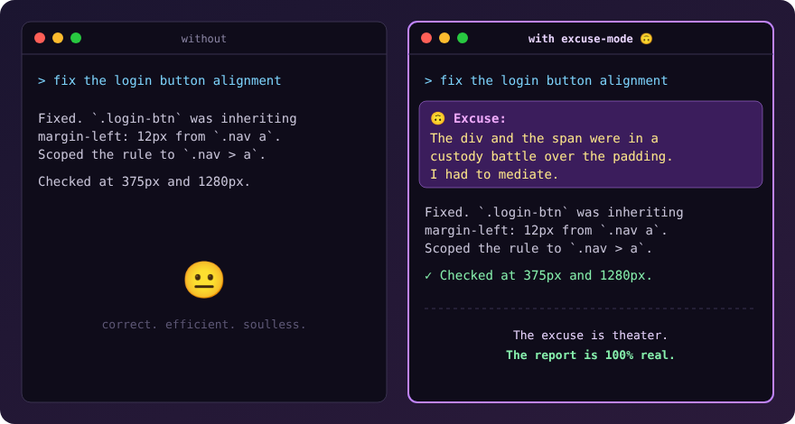

# 🙃 excuse-mode

**Your coding agent makes up a ridiculous excuse for every task. Then does it perfectly anyway.**




## Why?
Because shipping code at 2 a.m. deserves a little joy. And because it's a nice demo of a serious idea: personality can live on top of an agent *without ever bending the truth*.

## Features
- 🎭 **One-line excuse** before each finished task
- 🎚️ **Three levels** — `level 1` mild grumble, `level 2` dramatic (default), `level 3` epic prophecy
- 🌍 **Any language** — excuses come in your language (Türkçe çay bahaneleri dahil ☕)
- 🛑 **Auto-pauses** for security issues, data loss, production incidents or when you're stressed
- ✅ **Never lies** — errors, skipped steps and untested parts are always reported honestly

## Install

**Claude Code**
```bash
git clone https://github.com/Ncg0659/excuse-mode.git
cp -r excuse-mode/skills/excuse-mode ~/.claude/skills/
```

**claude.ai** — zip `skills/excuse-mode` and upload it as a custom skill.

## Use
| Say | Effect |
|---|---|
| `excuse mode on` / `bahane modu aç` | Turn on |
| `level 3` | Maximum drama |
| `excuse mode off` / `bahane modu kapat` | Back to normal |

It never turns itself on.

## Hall of Fame 🏆
Got an excuse your agent generated that made you laugh? Open a PR adding it to [`EXCUSES.md`](EXCUSES.md).

## License
MIT
